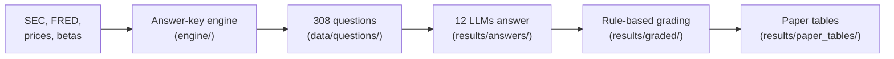

# Staged DCF Benchmark

**Evaluating Large Language Models on Multi-Step Discounted Cash Flow Valuation**

Hawon Kim and Jianna Hur, Department of Operations and Decision Technologies, Indiana University

A discounted cash flow (DCF) valuation is a chain of dependent steps, so one early mistake silently carries through to the value per share. This benchmark grades **every step** of a valuation against an exact answer key, so an error can be traced to the step where it happened.

- **308 questions** on **33 U.S. public companies** at three valuation dates (December 31 of 2019, 2022 and 2025)
- **12 open-weight LLMs**, six of them financial fine-tunes, each with and without a calculator
- **No LLM judge**: every checkpoint is scored by fixed rules
- **Reproducible on a laptop**: the paper's tables rebuild from the published answers in a few minutes, without a GPU

## How it works



1. **One correct answer per step.** Every judgment call (risk-free rate, equity risk premium, beta, tax, discounting, terminal growth) is stated in the question, so the engine computes a single value for every step. The key is the engine's value, not the market price, so it cannot be recalled from training data.
2. **Staged questions.** The same companies are asked at four lengths: a single calculation, Half A (forecast to free cash flows), Half B (discounting to value per share) and a full valuation. A company whose two halves are right but whose full valuation is wrong failed only in combining them: the *chain gap*.
3. **Step-level grading.** Each rubric item (2 points for an intermediate value, 5 for a step result, 10 for the final answer) must match within 0.01 percentage points for rates and 1% for dollar amounts.

## Repository layout

| Folder | What is inside |
|---|---|
| [`paper/`](paper/) | The paper (LaTeX), and where each figure, table and claim comes from |
| [`data/`](data/) | The 308 questions with rubrics, the engine's cases, raw SEC and FRED data |
| [`engine/`](engine/) | The answer-key engine (`dcfbench`): data adapters, valuation policies, the DCF, 350 tests |
| [`pipeline/`](pipeline/) | Scripts to build and audit the questions, run the models, grade and analyze |
| [`results/`](results/) | Every model answer, the graded files, the paper tables and the answer-key audit |
| [`slurm/`](slurm/), [`logs/`](logs/) | The cluster jobs of the model runs and every job log |
| [`docs/`](docs/) | [Step-by-step reproduction](docs/REPRODUCE.md) and [design notes and limitations](docs/PIPELINE.md) |

Each folder has its own README with the details.

## Quick start

Needs Python 3.11 or later and nothing else (no GPU, no packages):

```bash
make tables     # rebuild the paper tables from the graded answers and check they are identical (1 min)
make regrade    # regrade all 18,480 model answers from scratch, then rebuild the tables (4 min)
make audit      # check every answer key against an independent re-implementation of the DCF
make help       # all commands
```

Without `make`: `python pipeline/analyze_paper.py --graded results/graded --out my_tables`. Expected outputs for every step are in [`docs/REPRODUCE.md`](docs/REPRODUCE.md); rerunning the models on GPUs is described in [`slurm/README.md`](slurm/README.md).

## The benchmark

| Set (firms) | Single | Trap | Half A | Half B | Full, textbook | Full, practitioner | Total |
|---|---|---|---|---|---|---|---|
| 2025 (28) | 56 | 40 | 20 | 20 | 28 | 20 | 184 |
| 2019 (13) | | | 13 | 13 | 13 | 13 | 52 |
| 2022 (13) | | | 13 | 13 | 13 | 13 | 52 |
| Held-out 2025 (5) | | | 5 | 5 | 5 | 5 | 20 |
| **Total (33)** | 56 | 40 | 51 | 51 | 59 | 51 | **308** |

*Trap* questions also show the figure a common DCF error would produce. The *textbook* policy follows standard corporate finance conventions; the *practitioner* policy changes seven rules (for example the 10-year yield instead of the 3-month bill, a 5% instead of a 7% equity risk premium, mid-year discounting). Question format: [`data/README.md`](data/README.md).

## Models

| Group | Models |
|---|---|
| General instruction-tuned | Qwen2.5-7B-Instruct, Qwen2.5-32B-Instruct, Llama-3.1-8B-Instruct |
| Reasoning (thinking mode) | Qwen3-8B, Qwen3-14B, Qwen3-32B |
| Financial fine-tunes (base model) | Fin-R1 (Qwen2.5-7B), DianJin-R1-7B (Qwen2.5-7B), DianJin-R1-32B (Qwen2.5-32B), Fin-o1-8B (Qwen3-8B), Fin-o1-14B (Qwen3-14B), Fino1-8B (Llama-3.1-8B) |

Every model answers every question without and with a calculator (up to 300 calls). Reasoning models are sampled under three seeds (up to 24,576 tokens); the others decode greedily (up to 8,192 tokens). Settings: [`pipeline/run_model.py`](pipeline/run_model.py).

## Results

Accuracy (%) without and with (+C) the calculator (paper, Table II; [`results/paper_tables/tables_qa.md`](results/paper_tables/tables_qa.md)):

| Model (base) | Single | Full, textbook | All | All, +C |
|---|---|---|---|---|
| Qwen2.5-7B-Instruct | 78.6 | 0.0 | 25.6 | 26.3 |
| Qwen2.5-32B-Instruct | 80.4 | 0.0 | 34.4 | 56.5 |
| Llama-3.1-8B-Instruct | 33.9 | 0.0 | 9.7 | 12.3 |
| Qwen3-8B, thinking | 90.5 | 15.5 | 66.9 | 70.2 |
| Qwen3-14B, thinking | 97.6 | 33.3 | 75.6 | 71.5 |
| Qwen3-32B, thinking | 89.3 | 85.7 | 91.7 | 79.0 |
| Fin-R1 (Qwen2.5-7B) | 60.1 | 2.4 | 21.2 | 18.9 |
| DianJin-R1-7B (Qwen2.5-7B) | 88.1 | 0.0 | 30.5 | 31.7 |
| DianJin-R1-32B (Qwen2.5-32B) | 97.6 | 16.7 | 66.8 | 61.4 |
| Fin-o1-8B (Qwen3-8B) | 58.3 | 1.2 | 21.4 | 22.5 |
| Fin-o1-14B (Qwen3-14B) | 69.6 | 3.6 | 25.2 | 25.0 |
| Fino1-8B (Llama-3.1-8B) | 28.6 | 0.0 | 10.0 | 10.0 |

- **Accuracy falls as the workflow gets longer**, for every model. Most models fail when correctly solved steps are combined.
- **Errors concentrate in discounting and the equity bridge** (Steps 4 and 5), where small deviations are magnified.
- **A reasoning mode matters more** than model scale, financial fine-tuning or a calculator.

Where every figure, table and number of the paper comes from: [`paper/README.md`](paper/README.md).

## Evaluate your own model

Build the prompts the paper used, save one JSON line per answer, then grade:

```python
import json, sys
sys.path.insert(0, "pipeline")
from run_model import SYSTEM, load, build_prompts     # no GPU libraries needed

with open("answers_mymodel_s0_v2_L2345_20261101-120000.jsonl", "w") as out:
    for p in build_prompts(load("data/questions/QA_set_v2.json"), {2, 3, 4, 5}):
        reply = my_model(system=SYSTEM, user=p["prompt"])          # your model here
        out.write(json.dumps({"question_id": p["question_id"], "level": p["level"],
                              "prompt": p["prompt"], "response": reply}) + "\n")
```

```bash
python pipeline/grade.py --qa data/questions/QA_set_v2.json --answers answers_mymodel_s0_v2_L2345_20261101-120000.jsonl --out graded/mymodel
python pipeline/analyze_paper.py --graded graded --out tables
```

File naming, the other question sets and the calculator setting: [`pipeline/README.md`](pipeline/README.md#5-evaluating-another-model).

## Data availability

SEC EDGAR and FRED raw data are included. Yahoo Finance prices, Damodaran's tables and the licensed GICS sector export are not redistributed; the questions and cases contain the values derived from them. No API key is needed for anything above. Details: [`data/README.md`](data/README.md).

## Citation

```bibtex
@misc{kim2026staged,
  title  = {Evaluating Large Language Models on Multi-Step Discounted Cash Flow Valuation},
  author = {Kim, Hawon and Hur, Jianna and Samtani, Sagar},
  year   = {2026},
  note   = {Indiana University}
}
```

Also available as [`CITATION.cff`](CITATION.cff). Questions and issues are welcome through the issue tracker.
